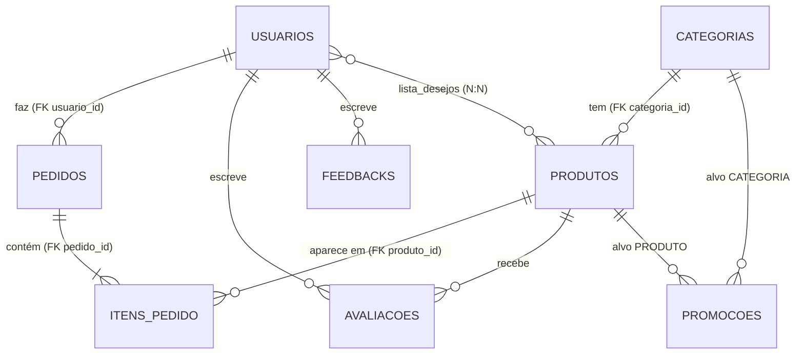

# TecShop — Etapa 2: back-end próprio e integração

Projeto e Desenvolvimento de Sistemas Web — UTFPR Santa Helena.

A TecShop é um e-commerce fictício com duas áreas: a **loja** (catálogo, busca, carrinho, checkout, lista de desejos, avaliações) e o **painel administrativo** (dashboard, produtos, categorias, pedidos, promoções, avaliações e relatórios). Nesta segunda etapa, o front-end em Next.js passou a funcionar sobre uma **API própria em NestJS**, com persistência em **SQLite**, autenticação **JWT**, autorização por perfil e documentação interativa em **Swagger UI**.

```
Trabalho_1_web/
├── Trabalho01-Web-main/   front-end (Next.js 16, React 19, Tailwind 4)
└── backend/               API (NestJS 11, TypeORM, SQLite, JWT, Swagger)
```

---

## 1. Objetivo

Substituir a Fake Store API e o `localStorage` da primeira etapa por um servidor próprio, que guarda os dados num banco de verdade, confere quem é cada usuário e o que ele pode fazer, e calcula preços, estoque e relatórios no servidor, sem confiar no navegador.

## 2. Conexão com a primeira etapa

Na primeira etapa a loja já estava completa do ponto de vista visual. Os produtos vinham uma única vez da Fake Store API e ficavam no `localStorage`, junto com usuários, pedidos, promoções e avaliações. Um cookie `tecshop_sessao` guardava o tipo do usuário para o `proxy.js` liberar as rotas privadas.

A própria documentação da etapa 1 apontava os limites dessa solução:

- senhas em texto puro no navegador;
- proteção que dependia do navegador (cookie e `localStorage` editáveis pelo F12);
- dados presos a um computador.

O front-end já tinha sido organizado para trocar o `localStorage` por chamadas ao servidor sem refazer as telas, e foi isso que aconteceu.

## 3. Problema que o back-end resolve

| Sem back-end (etapa 1) | Sintoma concreto |
|---|---|
| Senhas no `localStorage` | Qualquer um lia as senhas pelo F12 |
| Papel (ADMIN/CLIENTE) no cookie | Bastava editar o cookie para "virar" administrador |
| Preço calculado no navegador | O total do pedido podia ser alterado antes de enviar |
| Dados no navegador | Outro computador começava do zero; nada era compartilhado |
| Sem estoque | Vendia-se qualquer quantidade |
| Relatórios somados no navegador | Números dependiam do que estava salvo em cada máquina |

## 4. Meta

Uma TecShop que funciona com back-end NestJS próprio, persistência SQLite, autenticação JWT, autorização por perfil verificada no servidor, integração real com o front-end e documentação Swagger para testar todas as rotas pelo navegador.

## 5. Solução, por partes

### 5.1 Arquitetura em camadas (Controller → Service → Repository → Banco)

Cada assunto tem a própria pasta, com módulo, controller, service, repository, entidade e DTOs.

| Quem sabe sobre… | Controller | Service | Repository |
|---|---|---|---|
| HTTP (rota, params, body, status) | sim | não | não |
| Regras de negócio | não | sim | não |
| Como os dados são guardados | não | não | sim |

- **Controller fino**: recebe a requisição já validada pelo DTO e faz uma chamada ao service.
- **Service**: aplica as regras (estoque, transições de status, dono do recurso, preço promocional menor que o normal) e lança as exceções do Nest (`NotFoundException`, `ConflictException`…). Um service pede ao outro e nunca mexe no repository dos outros. Por exemplo, pedidos e carrinho usam o `ProdutosService`. (Alguns repositories leem tabelas de outros assuntos com join, como as contagens por categoria e os relatórios, para não cair no N+1; mas nenhum service injeta o repository de outro módulo.)
- **Repository**: só consulta e grava. Devolve `null` quando não acha, e o service transforma isso em 404. Filtros, ordenação e paginação são feitos no banco (`findAndCount`, `ILike`, `QueryBuilder`).
- **Injeção de dependência** pelo construtor em todos os pontos, sem `new`.

### 5.2 Banco de dados (SQLite + TypeORM)

- O arquivo fica em `backend/dados/tecshop.sqlite` (configurável por `DB_PATH`) e os dados continuam lá depois de reiniciar a API.
- O `synchronize` fica ligado **só em desenvolvimento**. Em produção (`NODE_ENV=production`) ele é desligado, e a migration `src/database/migrations/*-Inicial.ts` roda sozinha ao subir (`migrationsRun`).
- Dinheiro é gravado em `decimal(10,2)`, com um transformador que devolve `number`.
- Produto tem **exclusão lógica** (`@DeleteDateColumn`): some da loja, mas os pedidos antigos continuam apontando para ele.
- O pedido "fotografa" nome, imagem, categoria e preços de cada item na hora da compra. Assim o histórico não muda quando o produto muda.

#### Relacionamentos



| Relação | Tipo | Como foi feita |
|---|---|---|
| Categoria → Produtos | 1:N | `@ManyToOne` em `Produto` com `@JoinColumn({ name: 'categoria_id' })` (FK no lado N) |
| Usuário → Pedidos | 1:N | `@ManyToOne` em `Pedido` (`usuario_id`) |
| Pedido → Itens | 1:N | `@OneToMany` com `cascade: ['insert']`; `ItemPedido` é a entidade intermediária Pedido×Produto, com quantidade e preços |
| Usuário ↔ Produtos (lista de desejos) | N:N | `@ManyToMany` + `@JoinTable({ name: 'lista_desejos' })` |
| Produto → Avaliações | 1:N | `@ManyToOne` em `Avaliacao` |
| Promoção → Categoria **ou** Produto | N:1 | duas FKs anuláveis, preenchidas conforme o `alvo` |

### 5.3 API REST, DTOs e respostas padronizadas

- Recursos no plural e em minúsculas. O método HTTP é o verbo: GET consulta, POST cria, PATCH altera parte, DELETE remove (204).
- **DTO em todo body e toda query**, com `class-validator`/`class-transformer`. O `ValidationPipe` global usa `whitelist`, `forbidNonWhitelisted` e `transform`: campo que não está no DTO é recusado com 400. No PATCH (`PartialType` com `skipNullProperties: false`), campo ausente pode, mas campo `null` também é recusado com 400. Só o `precoPromocional` aceita `null`, que quer dizer "sem promoção".
- **Paginação** com limite máximo de 50: `{ itens, meta: { total, pagina, limite, paginas } }`.
- **Envelope único**:
  - sucesso: `{ "sucesso": true, "dados": ... }` (`RespostaInterceptor`);
  - erro: `{ "sucesso": false, "erro": { "status", "mensagem", "codigo?", "detalhes?" }, "caminho", "timestamp" }` (`TodosErrosFilter`). O que não é erro esperado vira 500 com mensagem genérica, e o detalhe vai só para o log. Nunca há stack trace na resposta.
- **Middleware de log**: método, URL, status e tempo, registrados no evento `finish`. Corpo, cabeçalhos e query string não entram no log (senha, token, dados pessoais).
- **Exceção própria**: `SemEstoqueException` (409, `codigo: "SEM_ESTOQUE"`).

### 5.4 Autenticação e segurança

- **bcrypt** (custo 10). A coluna `senha_hash` tem `select: false` e nunca aparece em nenhuma resposta.
- **Cadastro** sempre cria CLIENTE. O `RegistroDto` não tem campo `papel`, então `"papel": "ADMIN"` resulta em **400**.
- **Login**: a mensagem de erro é sempre "E-mail ou senha inválidos." (401). Quando o e-mail não existe, o login compara com um hash falso, para levar o mesmo tempo. Conta desativada recebe 403, e isso só é conferido depois da senha certa.
- **JWT** com payload mínimo `{ sub, email, papel }`, `JWT_SECRET` no `.env` e validade de 1 hora.
- **AuthGuard global** (seguro por padrão) + `@Publico()` nas rotas abertas, e **PapeisGuard** + `@Papeis('ADMIN')`. Sem token, ou com token inválido ou vencido, a resposta é **401**. Token de cliente numa rota de admin recebe **403**.
- **Dono do recurso** conferido no service: o cliente só vê os próprios pedidos. O pedido de outra pessoa responde **404**, para nem confirmar que aquele número existe. O dono do pedido vem sempre do token, nunca do corpo da requisição.
- **Preço nunca vem do navegador**: o pedido recebe só `produtoId` e `quantidade`. O servidor busca os preços no banco, baixa o estoque com `UPDATE … WHERE estoque >= quantidade` e grava pedido e itens numa **transação**, então se faltar estoque nada é gravado.

### 5.5 Documentação interativa (Swagger UI / OpenAPI)

- Fica em **http://localhost:3001/docs**, gerada pelo `@nestjs/swagger` a partir dos controllers e DTOs. O JSON do OpenAPI está em `/docs-json`.
- São 11 grupos (tags), com descrição, parâmetros, exemplos de corpo, respostas de sucesso no envelope e erros comuns (400, 401, 403, 404, 409, 422, 500) com exemplo.
- Rotas protegidas aparecem com cadeado (`@ApiBearerAuth`), e o resumo de cada rota indica **[Público]** ou **[ADMIN]**.
- Os decorators `@AcessoPublico()`, `@AcessoAutenticado()` e `@AcessoAdmin()` juntam a regra que os guards aplicam com a documentação, então as duas nunca ficam diferentes.
- Em produção a documentação só liga com `SWAGGER_ENABLED=true`.

### 5.6 Integração com o front-end

- **Camada de serviços em `lib/`**: `api.js` é o cliente HTTP central. Ele confere `res.ok`, trata falha de rede, desembrulha o envelope e valida as respostas com **Zod** (`esquemas.js`). Há um arquivo por assunto (`produtos.js`, `pedidos.js`, `auth.js`…), com funções de conversão para o formato que as telas já usavam.
- **Next como intermediário** (Route Handlers em `app/api/`): o navegador chama `/api/...` e o Next repassa para a API com `Authorization: Bearer`.
  - O JWT fica num **cookie `httpOnly`** (`secure` em produção, `sameSite=lax`), que o JavaScript da página não consegue ler.
  - Não existe nenhuma variável `NEXT_PUBLIC_`: a URL da API e o segredo só existem no servidor do Next.
- **`proxy.js`** agora confere a **assinatura e a validade** do JWT (HMAC SHA-256 com o mesmo `JWT_SECRET`, usando a Web Crypto do Node) antes de abrir as páginas privadas. Um token falso ou vencido volta para o login.
- **Estado no lugar certo**:
  - ficaram em Context só os estados globais de interface: tema, sessão, carrinho e lista de desejos;
  - produtos, pedidos, promoções e avaliações são dados do servidor, e cada página busca o que precisa pelo hook `useRequisicao` (estados de carregando, erro com "Tentar de novo", vazio e sucesso);
  - a busca usa `useDebounce` para não disparar uma requisição a cada letra.
- **Carrinho**: continua no navegador, porque o visitante também monta o dele. A cada mudança, o servidor recalcula preços e estoque (`POST /carrinho/calcular`), e a compra é conferida de novo no `POST /pedidos`.
- **Layout e identidade visual preservados.** As mudanças visíveis são:
  - aviso de "Esgotado" e de estoque no carrinho;
  - paginação quando há mais de uma página;
  - número do pedido na confirmação;
  - campo de estoque no cadastro de produto.

#### Funcionalidade do front → endpoint

| Tela / ação | Endpoint |
|---|---|
| Home e catálogo (busca, categoria, promoções, paginação) | `GET /produtos`, `GET /categorias?ativa=true` |
| Detalhe do produto e avaliações | `GET /produtos/:id`, `GET /avaliacoes?produtoId=`, `POST /avaliacoes` |
| Cadastro, login, sessão, sair | `POST /auth/registro`, `POST /auth/login`, `GET /auth/eu` (via `/api/auth/*` do Next) |
| Carrinho | `POST /carrinho/calcular` |
| Checkout / meus pedidos | `POST /pedidos`, `GET /pedidos/meus` |
| Lista de desejos | `GET`, `POST /lista-desejos`, `DELETE /lista-desejos/:produtoId` |
| Feedback do site | `GET /feedbacks`, `POST /feedbacks` |
| Painel: dashboard e relatórios | `GET /relatorios/dashboard`, `GET /relatorios/vendas` |
| Painel: produtos e categorias | `GET/POST/PATCH/DELETE /produtos`, `/categorias` |
| Painel: pedidos | `GET /pedidos`, `GET /pedidos/:id`, `PATCH /pedidos/:id/status` |
| Painel: promoções e moderação | `/promocoes`, `DELETE /avaliacoes/:id`, `DELETE /feedbacks/:id` |

`GET /usuarios` e `PATCH /usuarios/:id` não têm tela no painel: servem para consultar e desativar contas pelo Swagger.

## 6. Juntando tudo: o fluxo de uma compra

| Camada | O que acontece |
|---|---|
| Navegador | O cliente confirma o checkout. `lib/pedidos.js` envia só `{ produtoId, quantidade }` e os dados de entrega para `/api/pedidos` |
| Next (Route Handler) | Lê o JWT do cookie httpOnly e repassa para `POST http://localhost:3001/pedidos` com `Authorization: Bearer` |
| Middleware | Registra `POST /pedidos 201 - 12ms` quando a resposta termina |
| AuthGuard / PapeisGuard | Confere assinatura e validade do token e coloca `{ sub, email, papel }` em `req.usuario` |
| ValidationPipe + `CriarPedidoDto` | Recusa com 400 campo a mais (ex.: `preco`), CEP ou telefone fora do formato e lista vazia |
| `PedidosController` | Uma linha: `pedidosService.criar(dto, usuario)` |
| `PedidosService` | Abre a transação, confere se cada produto existe e está ativo (404), baixa o estoque (409 se faltar), calcula preços e total com os dados do banco e define o dono pelo token |
| Repositories | Gravam pedido e itens (cascade) e atualizam o estoque, tudo pelo `manager` da transação |
| SQLite | `COMMIT`, ou `ROLLBACK` se qualquer etapa falhar |
| `RespostaInterceptor` | Devolve `201 { sucesso: true, dados: pedido }` |
| Navegador | Mostra "Pedido #N realizado!", limpa o carrinho, e o pedido aparece em "Meus pedidos" e no dashboard |

## 7. Checklist e armadilhas evitadas

**Feito sempre**
- [x] Validar na entrada (DTO + `ValidationPipe`), conferir antes de mudar (busca antes de PATCH/DELETE), salvar tudo ou nada (transação)
- [x] Status HTTP corretos: 201 ao criar, 204 ao excluir, 401, 403, 404, 409 e 422; nunca 200 com erro
- [x] Filtrar, ordenar e paginar no banco, com limite máximo
- [x] Segredos no `.env`, fora do Git (`.env.example` sem segredos)
- [x] Testar o erro tanto quanto o sucesso

**Armadilhas evitadas**
- **Confiar no preço do navegador**: o DTO do pedido nem aceita preço.
- **Esconder botão como "proteção"**: toda regra vale na API, e o cliente recebe 403 mesmo chamando direto.
- **Esquecer de proteger rota nova**: o guard é global e só `@Publico()` abre a rota.
- **Devolver o hash da senha**: `select: false` e o usuário é sempre recarregado sem o hash.
- **Duas compras levarem a última unidade**: a condição de estoque fica dentro do próprio `UPDATE`.
- **N+1**: as contagens por categoria usam `GROUP BY` e as relações vêm com `relations`.
- **Paginar com join ordenando pelos itens**: com `skip`/`take`, o TypeORM passaria a contar linhas pedido×item, e pedidos sumiriam da lista. O SQL ordena só pelo pedido, e os itens são ordenados depois da consulta.
- **`synchronize` em produção**: fica desligado lá, e quem cria as tabelas é a migration.
- **Token no `localStorage`**: ele fica em cookie httpOnly.

## 8. Conclusão

**O controller traduz, o service decide, o repository guarda, e o navegador não decide nada que valha dinheiro ou permissão.**

---

## Tecnologias

| Camada | Tecnologia | Versão |
|---|---|---|
| Front-end | Next.js (App Router, Route Handlers, `proxy.js`) | 16.3 |
| | React / React Hook Form / Zod / Tailwind CSS | 19.3 / 7.89 / 4.6 / 4.3 |
| Back-end | NestJS (`@nestjs/core`, `config`, `typeorm`, `jwt`, `swagger`) | 11.2 / 4.0 / 11.0 / 11.0 / 11.4 |
| Banco | SQLite com `better-sqlite3` + TypeORM | 12.11 + 0.3.31 |
| Segurança | bcrypt, JWT (HS256) | 6.0 |
| Validação | class-validator / class-transformer | 0.15 / 0.5 |
| Testes | Jest + Supertest | 30.5 |

> **Por que NestJS 11 e não 12?** O NestJS 12 (agosto de 2026) passou a ser distribuído só como ESM. Isso complica o Jest (exigido pela atividade) e os decorators de entidades do TypeORM. A linha 11 é CommonJS, continua recebendo atualizações (11.2.9) e é compatível com todos os módulos oficiais usados.

## Estrutura do back-end

```
backend/
├── src/
│   ├── main.ts                    sobe a API, CORS, Swagger
│   ├── configurar-aplicacao.ts    ValidationPipe, filtro e interceptor globais
│   ├── swagger.ts                 DocumentBuilder, Bearer JWT, tags
│   ├── app.module.ts              ConfigModule, TypeORM, módulos, middleware de log
│   ├── config/                    validação do .env
│   ├── database/                  opções do SQLite, data-source da CLI, migrations
│   ├── comum/                     decorators (Publico, Papeis, UsuarioAtual, Acesso*, Swagger),
│   │                              dto (paginação, erro), filtros, interceptors, middlewares
│   ├── auth/                      controller, service, auth.guard, papeis.guard, dto
│   ├── usuarios/                  entity, repository, service, controller, dto
│   ├── categorias/   produtos/   carrinho/   pedidos/ (pedido + item-pedido)
│   ├── lista-desejos/   promocoes/   avaliacoes/   feedback/   relatorios/
│   └── seed/                      popular-banco.ts, seed.ts, dados iniciais
└── test/tecshop.e2e-spec.ts       testes de integração (banco temporário)
```

## Configuração (variáveis de ambiente)

**`backend/.env`** (copie de `backend/.env.example`):

| Variável | Para que serve | Exemplo |
|---|---|---|
| `PORT` | Porta da API | `3001` |
| `NODE_ENV` | `development` ou `production` | `development` |
| `DB_PATH` | Arquivo do SQLite | `./dados/tecshop.sqlite` |
| `JWT_SECRET` | Segredo do JWT (mínimo 32 caracteres) | gere com o comando abaixo |
| `JWT_EXPIRES_IN` | Validade do token, sempre com unidade (só o número seria lido como milissegundos, e a API não sobe) | `1h` |
| `ADMIN_NOME` / `ADMIN_EMAIL` / `ADMIN_PASSWORD` | Conta admin criada pelo seed (a senha vem vazia no modelo: defina a sua) | `admin@tecshop.com` / senha à sua escolha |
| `FRONTEND_URL` | Origem liberada no CORS | `http://localhost:3000` |
| `SWAGGER_ENABLED` | Opcional. Sem ela, o `/docs` fica ligado em desenvolvimento e desligado em produção | `true` ou `false` |

Gerar um segredo: `node -e "console.log(require('crypto').randomBytes(48).toString('hex'))"`

**`Trabalho01-Web-main/.env.local`** (copie de `Trabalho01-Web-main/.env.example`):

| Variável | Para que serve |
|---|---|
| `API_URL` | Endereço da API (`http://localhost:3001`) |
| `JWT_SECRET` | **O mesmo** valor do `backend/.env` (o `proxy.js` confere a assinatura do token) |

`.env`, `.env.local` e o arquivo `.sqlite` estão no `.gitignore` e não vão para o Git.

## Como executar

Requisito: Node.js 20 ou superior (testado com Node 24).

```bash
# 1) back-end
cd backend
npm install
cp .env.example .env          # e preencha JWT_SECRET e ADMIN_PASSWORD
npm run seed                  # cria admin, categorias, 20 produtos, avaliações e feedbacks
npm run start:dev             # API em http://localhost:3001 (Swagger em /docs)

# 2) front-end (em outro terminal)
cd Trabalho01-Web-main
npm install
cp .env.example .env.local    # API_URL e o mesmo JWT_SECRET do backend
npm run dev                   # loja em http://localhost:3000
```

**Conta administrativa:** o e-mail de `ADMIN_EMAIL` (`admin@tecshop.com`) com a senha que você definir em `ADMIN_PASSWORD`. A senha fica só no `.env`, que não vai para o Git, e no banco é gravada só como hash. Sem senha definida, o seed não cria o admin e avisa. Em produção, o seed recusa a senha de demonstração `admin123`.

O seed pode rodar quantas vezes for preciso sem duplicar nada:

- o admin só é criado se o e-mail ainda não existir;
- as categorias só são criadas se o nome ainda não existir;
- produtos, avaliações e feedbacks iniciais só entram com a tabela vazia.

Os produtos iniciais são os 20 da Fake Store, copiados uma única vez para `backend/src/seed/dados`. A API não depende mais do serviço externo.

Outros comandos do back-end:

| Comando | O que faz |
|---|---|
| `npm run build` / `npm run start:prod` | Compila / roda o build |
| `npm test` | Testes unitários dos services |
| `npm run test:e2e` | Testes de integração (sobem a API com um banco temporário) |
| `npm run lint` | ESLint + Prettier (com `--fix`: já corrige a formatação nos arquivos) |
| `npm run seed:prod` | Seed usando o build (`dist/`) |
| `npm run migration:gerar -- src/database/migrations/Nome` | Gera migration a partir das entidades (contra um banco criado só pelas migrations; ver `src/database/data-source.ts`) |

**Produção:** `NODE_ENV=production` desliga o `synchronize` e roda as migrations ao subir. O Swagger fica desligado (a não ser com `SWAGGER_ENABLED=true`) e o cookie do token passa a ser `secure`.

## Swagger UI: como usar

1. Com a API rodando, abra **http://localhost:3001/docs**.
2. Em **Autenticação → POST /auth/login**, clique em **Try it out**, envie `{ "email": "admin@tecshop.com", "senha": "<a senha do ADMIN_PASSWORD>" }` e clique em **Execute**.
3. Copie o valor de `dados.token` da resposta.
4. Clique em **Authorize** (cadeado no topo), cole **só o token** (o Swagger acrescenta `Bearer` sozinho) e confirme.
5. As rotas com cadeado passam a funcionar, até as **[ADMIN]**. Para testar como cliente, crie uma conta em `POST /auth/registro` e use o token dela: as rotas de admin respondem 403.
6. Rotas **[Público]** não precisam de token. Os filtros opcionais vêm vazios, então o **Try it out** de `GET /produtos` lista tudo.

## Endpoints

Legenda de acesso: **Público** (sem token), **Logado** (CLIENTE ou ADMIN), **ADMIN**. Toda rota pode responder 500 em falha inesperada. Rotas com token respondem 401 sem token ou com token inválido/vencido, e rotas de ADMIN respondem 403 a clientes.

| Método | Rota | Acesso | Sucesso | Erros esperados |
|---|---|---|---|---|
| POST | `/auth/registro` | Público | 201 + token | 400, 409 |
| POST | `/auth/login` | Público | 200 + token | 400, 401, 403 (conta desativada) |
| GET | `/auth/eu` | Logado | 200 | 401 |
| GET | `/usuarios` | ADMIN | 200 paginado | 400 |
| PATCH | `/usuarios/:id` | ADMIN | 200 | 400, 404, 422 |
| GET | `/produtos` | Público (inativos: ADMIN) | 200 paginado | 400, 403 |
| GET | `/produtos/:id` | Público | 200 (+ média das notas) | 400, 404 |
| POST | `/produtos` | ADMIN | 201 | 400, 404 (categoria), 422 |
| PATCH | `/produtos/:id` | ADMIN | 200 | 400, 404, 422 |
| DELETE | `/produtos/:id` | ADMIN | 204 (soft delete) | 404 |
| GET | `/categorias` | Público | 200 | 400 |
| GET | `/categorias/:id` | Público | 200 | 404 |
| POST | `/categorias` | ADMIN | 201 | 400, 409 |
| PATCH | `/categorias/:id` | ADMIN | 200 | 400, 404, 409 |
| DELETE | `/categorias/:id` | ADMIN | 204 | 404, 409 (tem produtos) |
| POST | `/carrinho/calcular` | Público | 200 | 400 |
| POST | `/pedidos` | Logado | 201 | 400, 404, 409 (`SEM_ESTOQUE`) |
| GET | `/pedidos/meus` | Logado | 200 paginado | 400 |
| GET | `/pedidos` | ADMIN | 200 paginado | 400 |
| GET | `/pedidos/:id` | Dono ou ADMIN | 200 | 404 (inclusive pedido de outro cliente) |
| PATCH | `/pedidos/:id/status` | ADMIN | 200 | 400, 404, 422 (transição inválida) |
| GET | `/lista-desejos` | Logado | 200 paginado | 400 |
| POST | `/lista-desejos` | Logado | 201 | 400, 404, 409 |
| DELETE | `/lista-desejos/:produtoId` | Logado | 204 | 404 |
| GET | `/promocoes` | Público (`situacao=TODAS`: ADMIN) | 200 | 400, 403 |
| GET | `/promocoes/:id` | Público | 200 | 404 |
| POST | `/promocoes` | ADMIN | 201 | 400, 404, 422 |
| PATCH | `/promocoes/:id` | ADMIN | 200 | 400, 404, 422 |
| DELETE | `/promocoes/:id` | ADMIN | 204 | 404 |
| GET | `/avaliacoes` | Público (e-mail do autor só para ADMIN) | 200 paginado | 400 |
| POST | `/avaliacoes` | Logado | 201 | 400, 404 |
| DELETE | `/avaliacoes/:id` | ADMIN | 204 | 404 |
| GET | `/feedbacks` | Público | 200 paginado | 400 |
| POST | `/feedbacks` | Logado | 201 | 400 |
| DELETE | `/feedbacks/:id` | ADMIN | 204 | 404 |
| GET | `/relatorios/dashboard` | ADMIN | 200 | — |
| GET | `/relatorios/vendas` | ADMIN | 200 | 400, 422 |

## Testes executados

Executados em 11/11/2026. Todos passaram. As linhas marcadas com "(equipe)" são da verificação feita antes da revisão do código; as demais foram executadas de novo depois das correções.

| Suíte | Ferramenta | Resultado |
|---|---|---|
| Testes unitários dos services (pedidos, auth, produtos, categorias, promoções) | Jest, dependências falsas com `jest.fn()` | **26/26** |
| Testes de integração da API (inclui 8 testes de regressão da revisão) | Jest + Supertest, banco SQLite temporário | **57/57** |
| Fluxos corrigidos na revisão, no navegador (build de produção + API) | Chrome headless (DevTools Protocol) | **13/13** verificações |
| Fluxo completo no navegador (front + API) (equipe) | Chrome headless (puppeteer) | **37/37** verificações |
| Swagger UI no navegador (Try it out + Authorize) (equipe) | Chrome headless (puppeteer) | **14/14** verificações |
| Build do back-end / do front-end | `nest build` / `next build` | sem erros |
| Lint do back-end | ESLint + Prettier (type-checked) | sem erros |
| Modo produção (equipe) | `NODE_ENV=production` com banco vazio | migration criou as tabelas; `/docs` 404; seed recusou `admin123` |

Cenários da tabela pedida, todos cobertos pelos testes de integração (`backend/test/tecshop.e2e-spec.ts`):

| Requisição | Cenário | Esperado | Obtido |
|---|---|---|---|
| POST /auth/registro | Dados válidos | 201 | 201 (CLIENTE, sem senha na resposta) |
| POST /auth/registro | E-mail duplicado | 409 | 409 |
| POST /auth/registro | Enviar `papel: ADMIN` | 400 | 400 (`property papel should not exist`) |
| POST /auth/login | Credenciais válidas | 200 + JWT | 200, payload `{ sub, email, papel }`, validade 3600 s |
| POST /auth/login | Senha incorreta | 401 | 401, "E-mail ou senha inválidos." |
| GET /produtos | Consulta pública | 200 | 200 paginado |
| GET /produtos/:id | Inexistente | 404 | 404 |
| POST /produtos | Cliente | 403 | 403 |
| POST /produtos | Admin, dados válidos | 201 | 201 |
| PATCH /produtos/:id | Dados válidos | 200 | 200 (só o campo enviado muda) |
| DELETE /produtos/:id | Existente | 204 | 204; de novo, 404 |
| GET /pedidos/meus | Sem token | 401 | 401 |
| GET /pedidos/meus | Cliente | 200 | 200, só os pedidos dele |
| GET /pedidos/:id | Pedido de outro cliente | Acesso negado | 404 |
| PATCH /pedidos/:id/status | Cliente | 403 | 403 |
| POST /pedidos | Pedido válido | 201 | 201, total calculado no servidor, estoque baixado |
| POST /pedidos | Produto inexistente | 404 | 404 |
| POST /pedidos | Estoque insuficiente | 409 | 409 `SEM_ESTOQUE`, nada gravado (rollback) |
| GET /categorias | Consulta | 200 | 200 |

Também verificados:

- **Segurança:** JWT expirado e JWT adulterado (401); senha gravada como hash bcrypt; preço enviado pelo navegador recusado (400); conta desativada não entra (403); transição de status inválida (422).
- **Regras de negócio:** cancelar devolve o estoque; promoção aplica e retira o preço promocional; categoria com produtos não é excluída (409).
- **Infraestrutura:** dashboard calculado a partir dos pedidos gravados; persistência depois de reiniciar a API; documento OpenAPI com as 11 tags, o esquema Bearer e o cadeado só nas rotas protegidas.
- **Regressões da revisão** (bloco "Regressões da revisão" em `backend/test/tecshop.e2e-spec.ts`; cada teste falhava antes da correção): paginação de pedidos com vários itens; desativar e excluir promoção vencida devolvem o preço normal; `null` em campo obrigatório responde 400 (antes 500); promoções sobrepostas valem pelo menor preço; promoção de produto excluído some da lista pública; avaliação de produto inativo só aparece para o admin; relatório filtrado por produto conta só os pedidos que têm o produto.
- **No navegador, depois das correções:** carrinho adulterado no `localStorage` não derruba o site; "Finalizar compra" → login → volta para o `/checkout` (build de produção); sessão vencida avisa "Sua sessão expirou" e mantém o carrinho; o login não entra em laço quando o token vence; redirect para outro site depois do login é recusado; formulários de categorias e promoções com React Hook Form + Zod; o PATCH da edição de produto manda só o que mudou; excluir o único item da última página mantém a paginação.

## Ajustes pedidos na correção da primeira etapa

- **Limpar o localStorage ao sair:** ao sair, o carrinho é apagado do `localStorage` e o cookie do token é removido. Isso acontece só no "Sair": quando a sessão apenas vence (1 hora), o carrinho continua guardado e a pessoa entra de novo para terminar a compra. Os dados que a primeira etapa guardava no navegador (inclusive a lista de usuários com senhas) agora moram no banco e são limpos do `localStorage` quando o site abre.
- **F5 não perde os filtros do Início:** categoria e busca ficam na URL (`/?categoria=Joias&busca=anel`). Com isso, sobrevivem ao F5 e o link pode ser compartilhado; a filtragem é feita pela API.

## Limitações identificadas

- **Imagens:** as dos produtos iniciais continuam hospedadas na Fake Store. Só o endereço fica no banco, e não há upload de imagens.
- **Carrinho:** fica no navegador (decisão de projeto, para o visitante poder usar) e não acompanha o usuário entre dispositivos.
- **Sessão:** não há refresh token, então depois de 1 hora é preciso entrar de novo (a tela avisa "Sua sessão expirou" e o carrinho continua guardado). Como o JWT é stateless, desativar uma conta não derruba um token já emitido até ele vencer.
- **Promoções:** seguem a regra da primeira etapa, em que o preço promocional é gravado no produto quando a promoção passa a valer.
  - Uma promoção criada para começar no futuro não é aplicada sozinha quando a data chega, e é preciso editá-la ou reativá-la no dia.
  - Uma promoção vencida e ainda ativa continua com o desconto até ser desativada ou excluída. O painel avisa quando isso acontece.
  - Se duas promoções alcançam o mesmo produto (uma da categoria e outra só dele), vale o menor preço.
  - O preço promocional é calculado quando a promoção é aplicada. Se o preço do produto mudar, ou se um produto entrar ou sair de uma categoria em promoção, é preciso editar a promoção (ou desativar e ativar de novo) para recalcular. Baixar o preço para menos que o promocional gravado responde 422.
- **Busca:** a busca sem diferenciar maiúsculas do SQLite funciona só para letras sem acento ("ELETRÔNICOS" não encontra "Eletrônicos").
- **Relatórios:** agrupam os dias pelo fuso horário do servidor.
- **Lint do front:** o front-end não tem ESLint configurado (o Next 16 removeu o `next lint`). A validação foi feita pelo build e pelos testes no navegador.

## Próximos passos

- Job agendado (`@nestjs/schedule`) para ligar e desligar promoções pelas datas.
- Refresh token e lista de tokens revogados.
- `@nestjs/throttler` no login e `helmet()`.
- TanStack Query no front (cache e retry).
- Upload de imagens.
- Testes de componentes com Testing Library/MSW.
- Deploy com banco gerenciado e migrations no pipeline.
